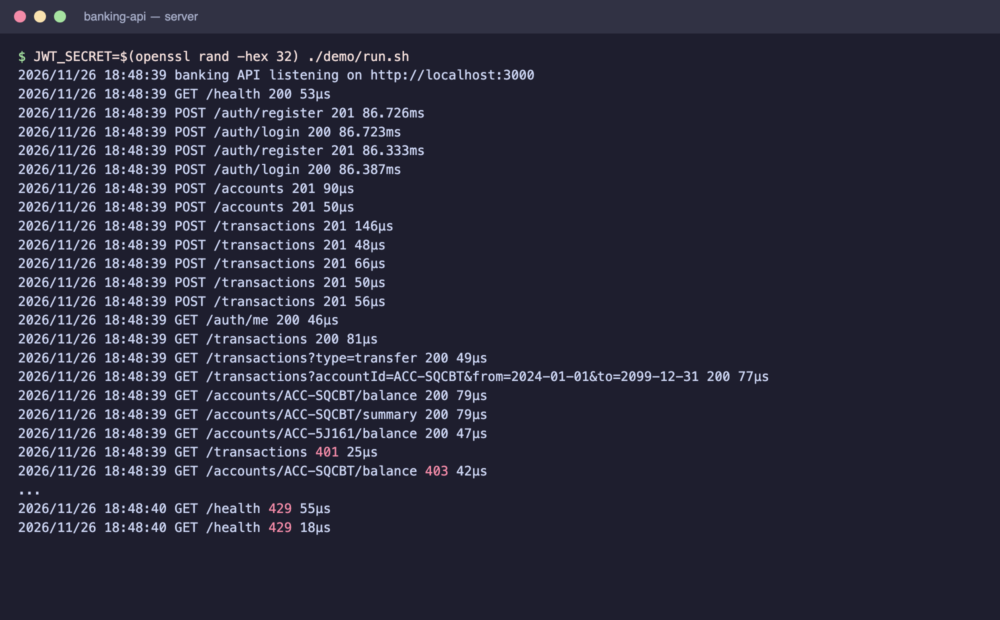
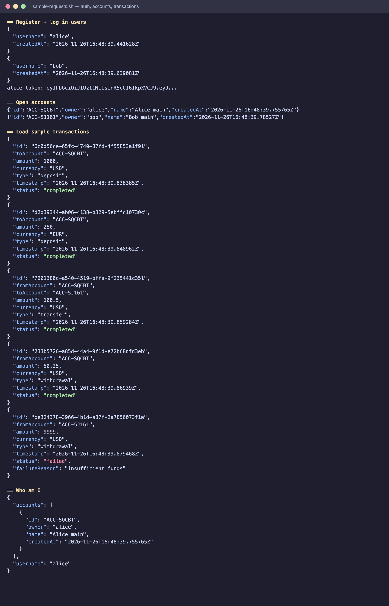
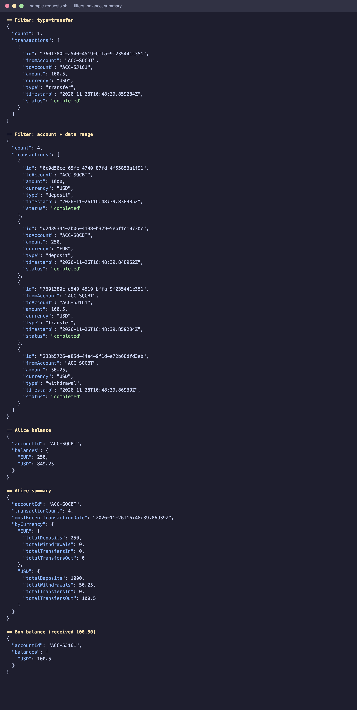
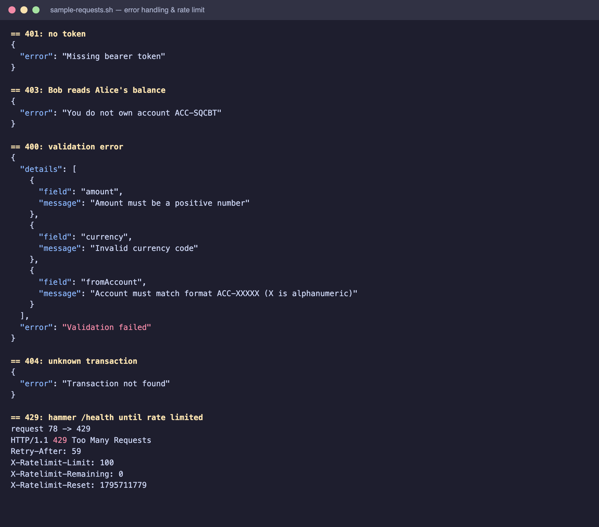
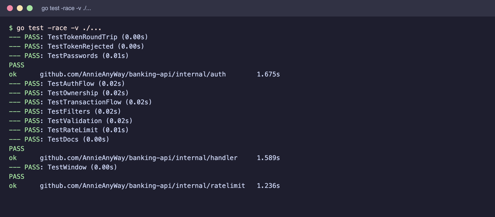
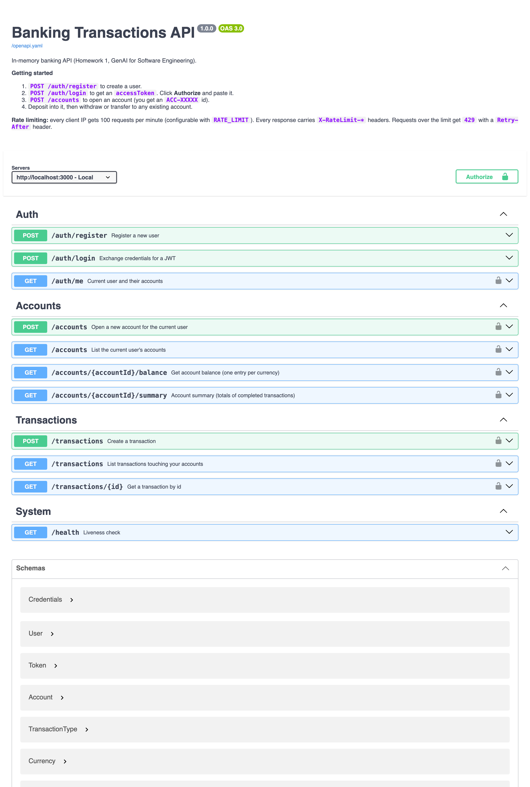
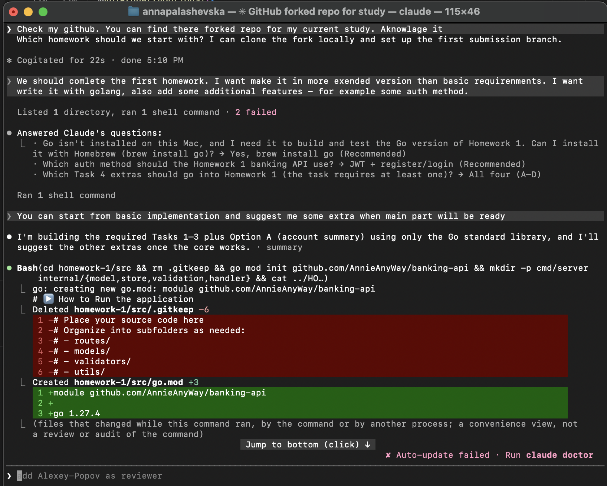
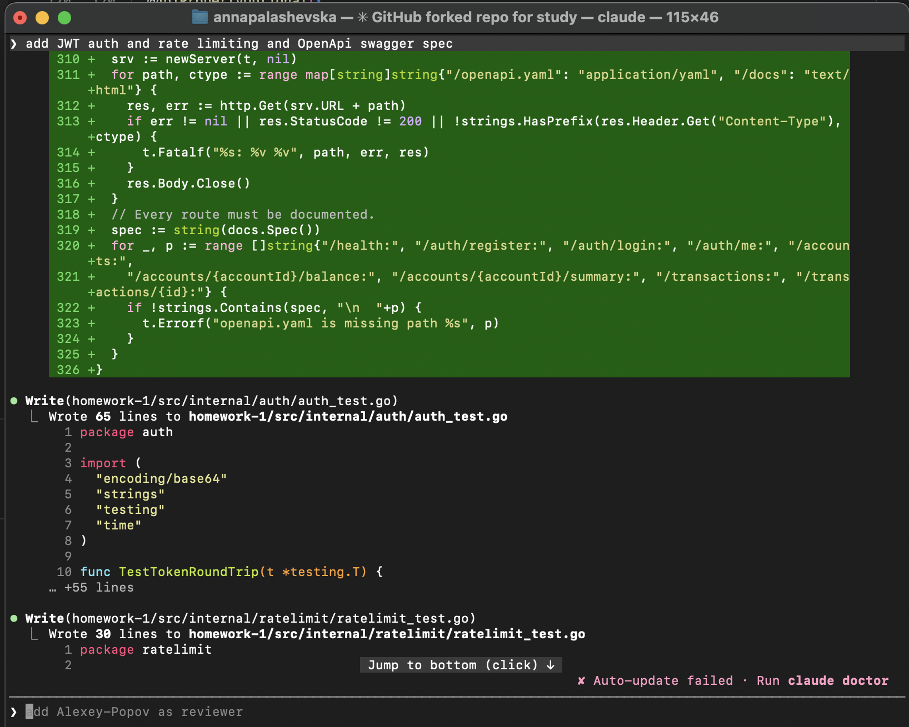
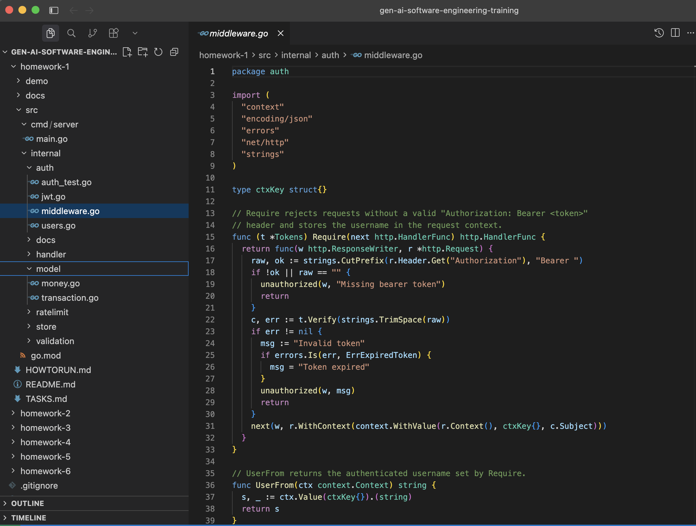

# 🏦 Homework 1: Banking Transactions API

> **Student Name**: Anna Palashevska
> **Date Submitted**: 2026-11-26
> **AI Tools Used**: Claude Code (Claude Opus 5.5)

---

## 📋 Project Overview

A REST API for banking transactions written in **Go**, using **only the standard library** (no external dependencies). It supports deposits, withdrawals and transfers between user-owned accounts. On top of that it has **JWT authentication**, **per-IP rate limiting** and an **OpenAPI 3 spec with Swagger UI**.

## ✅ Features Implemented

| Task | Status | Details |
|------|--------|---------|
| 1. Core API | ✅ | `POST /transactions`, `GET /transactions`, `GET /transactions/{id}`, `GET /accounts/{accountId}/balance` |
| 2. Validation | ✅ | Positive amount with at most 2 decimals, `ACC-XXXXX` account format, ISO 4217 currency, type-specific required fields. Returns all errors at once |
| 3. History filters | ✅ | `accountId`, `type`, `from`, `to`, and any combination of them |
| 4A. Summary | ✅ | `GET /accounts/{accountId}/summary` |
| 4D. Rate limiting | ✅ | 100 requests per minute per IP, then `429` with `Retry-After` and `X-RateLimit-*` headers |
| ⭐ JWT auth | ✅ | Register and log in, HS256 tokens, PBKDF2 password hashing, account ownership |
| ⭐ OpenAPI / Swagger | ✅ | `GET /openapi.yaml`, interactive UI at `GET /docs` |

**Also included:** `GET /health`, request logging, panic recovery, graceful shutdown, HTTP timeouts, 1 MB body limit, rejection of unknown JSON fields, and unit and integration tests run with the race detector.

## 🔌 API

Swagger UI is at **http://localhost:3000/docs**. Log in, click **Authorize**, paste the token, and you can try any endpoint.

| Method | Endpoint | Auth | Success | Errors |
|--------|----------|------|---------|--------|
| `POST` | `/auth/register` | — | 201 | 400, 409 |
| `POST` | `/auth/login` | — | 200 `{accessToken, tokenType, expiresIn, expiresAt}` | 400, 401 |
| `GET` | `/auth/me` | 🔒 | 200 | 401 |
| `POST` | `/accounts` | 🔒 | 201 (new `ACC-XXXXX`) | 400, 401 |
| `GET` | `/accounts` | 🔒 | 200 | 401 |
| `POST` | `/transactions` | 🔒 | 201 + `Location` header | 400, 401, 403, 404 |
| `GET` | `/transactions?accountId=&type=&from=&to=` | 🔒 | 200 `{count, transactions}` | 400, 401, 403, 404 |
| `GET` | `/transactions/{id}` | 🔒 | 200 | 401, 404 |
| `GET` | `/accounts/{accountId}/balance` | 🔒 | 200 `{accountId, balances: {USD: 849.25}}` | 400, 401, 403, 404 |
| `GET` | `/accounts/{accountId}/summary` | 🔒 | 200 | 400, 401, 403, 404 |
| `GET` | `/health`, `/openapi.yaml`, `/docs` | — | 200 | — |

Any endpoint can also return `429 Too Many Requests`.

### 🔐 Authentication and authorization
- **Register and log in:** usernames are case-insensitive. Passwords must be 8–72 characters and are hashed with **PBKDF2-HMAC-SHA256, 600k iterations and a random salt**, which matches the OWASP recommendation.
- **JWT:** HS256, signed with `JWT_SECRET`, valid for 1 hour by default (`JWT_TTL`). The server rejects tokens with a bad signature, a changed payload, `alg: none`, the wrong issuer, or an expired date.
- **Login doesn't reveal which usernames exist.** For an unknown user the server still runs the password hash, so the response takes as long as a wrong password, and both cases return the same `401` message.
- **Account ownership:** every account belongs to the user who opened it.
  - Deposits and withdrawals are only allowed on your own accounts.
  - Transfers must come **from** your own account but can go **to** any existing account.
  - Balance, summary and the `accountId` filter return `403` for other users' accounts.
  - Transaction lists only show transactions that involve your accounts.
  - `GET /transactions/{id}` returns `404` (not `403`) for other users' transactions, so it never confirms that an ID exists.

### 🚦 Rate limiting
- Fixed window per client IP. The default is 100 requests per minute, set with `RATE_LIMIT`.
- Every response carries the headers `X-RateLimit-Limit`, `X-RateLimit-Remaining` and `X-RateLimit-Reset`. A blocked request gets `429` with `Retry-After`.
- The client IP is taken from the TCP connection, not from `X-Forwarded-For`, because clients can fake that header. Old entries are cleaned up regularly, so memory doesn't keep growing.

### Transaction rules
| Type | `fromAccount` | `toAccount` | Effect |
|------|---------------|-------------|--------|
| `deposit` | must not be set | required (yours) | credits `toAccount` |
| `withdrawal` | required (yours) | must not be set | debits `fromAccount` |
| `transfer` | required (yours) | required (any existing account, must be different) | moves money between the two accounts |

- If a withdrawal or transfer is larger than the source balance in that currency, it is **still saved, with `status: "failed"`** and `failureReason: "insufficient funds"`. This keeps the history complete, and the balance doesn't change.
- Balances are kept **separately for each currency**. There is no currency conversion.
- `from` and `to` accept `YYYY-MM-DD` or RFC 3339. A plain `to` date includes that whole day.

### Example validation error
```json
{
  "error": "Validation failed",
  "details": [
    {"field": "amount", "message": "Amount must be a positive number"},
    {"field": "currency", "message": "Invalid currency code"}
  ]
}
```

## ⚙️ Configuration
| Env var | Default | Meaning |
|---------|---------|---------|
| `PORT` | `3000` | HTTP port |
| `JWT_SECRET` | random value on each start | HMAC key, at least 32 characters. If unset, tokens stop working after a restart |
| `JWT_TTL` | `1h` | How long a token is valid (Go duration format) |
| `RATE_LIMIT` | `100` | Requests per minute per IP |

## 🏗️ Architecture

```
src/
├── cmd/server/main.go          # config from env, http.Server, graceful shutdown
└── internal/
    ├── model/                  # Transaction, Account, Filter, Money
    ├── validation/             # request DTO + field validation
    ├── store/                  # thread-safe in-memory ledger + accounts
    ├── auth/                   # JWT (HS256), PBKDF2 users, Bearer middleware
    ├── ratelimit/              # per-IP fixed-window limiter + middleware
    ├── docs/                   # embedded openapi.yaml + Swagger UI page
    └── handler/                # routes, ownership checks, JSON I/O, tests
```

Each request passes through: logging → panic recovery → rate limiter → router → JWT check (protected routes only) → handler → store.

**Design decisions**
- **Money is stored as `int64` minor units (cents)**, never `float64`. The amount is read from the raw JSON text, so "at most 2 decimals" is checked exactly, and strings or exponent notation (`"10"`, `1e3`) are rejected.
- **No dependencies.** JWT is about 60 lines on top of `crypto/hmac`, and password hashing uses `crypto/pbkdf2` (in the standard library since Go 1.24). The JWT code is small and has its own tests for the known attacks (`alg: none`, a changed payload, the wrong key, expiry). In a production service I would use a well-reviewed library such as `golang-jwt` together with bcrypt or argon2.
- **Account IDs are generated by the server**, so nobody can claim someone else's account number. This is what makes the ownership rules enforceable.
- **Go 1.22+ `ServeMux` patterns** (`GET /transactions/{id}`) handle routing without a framework.
- **The OpenAPI spec is embedded with `go:embed`**, so the binary serves its own docs. A test checks that every route is in the spec.

## 🤖 How AI Was Used
- Claude Code read the assignment (`TASKS.md`) and the repository's submission rules, then proposed the Go layout and design decisions above.
- I built it in two rounds: first the required Tasks 1–3 plus the summary, then JWT auth, rate limiting and the OpenAPI spec as extensions.
- Claude Code generated the model, validation, store, auth, rate limiter, handlers, OpenAPI spec, tests and demo scripts. I reviewed each part.
- While running the demo script on macOS, we found that the system bash (3.2) has no associative arrays and brace-expands JSON inside nested `"$(...)"`. The script was rewritten to work with it.
- I checked the result by running the server and the demo script, and by running `go vet` and `go test -race`. The tests found that quoted amounts (`"amount": "10"`) were being accepted. The AI changed the amount parsing to fix this.

## 📸 Screenshots

| | |
|---|---|
| Server running with request log |  |
| Auth, accounts and transactions |  |
| Filters, balance and summary |  |
| 401 / 403 / 400 / 404 / 429 handling |  |
| Test suite (`go test -race`) |  |
| Swagger UI |  |
| AI prompts in Claude Code |  |
| AI-generated code (JWT, rate limit, OpenAPI tests) |  |
| Project structure in the editor |  |

<div align="center">

*This project was completed as part of the AI-Assisted Development course.*

</div>
